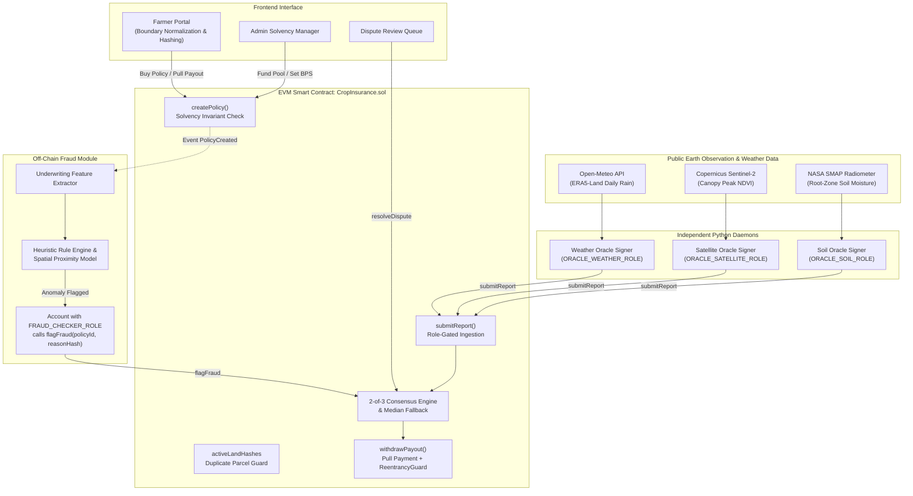
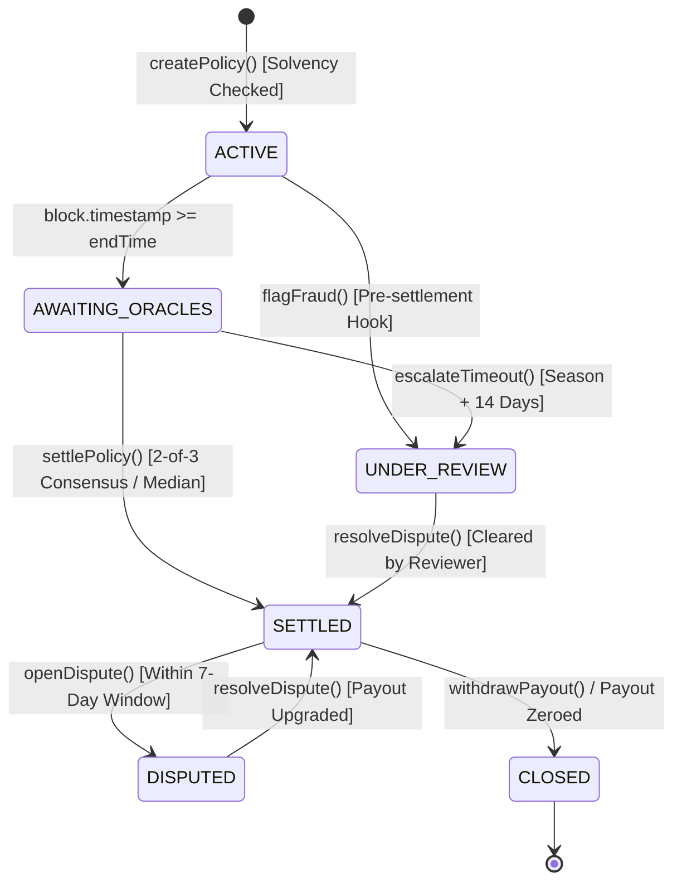
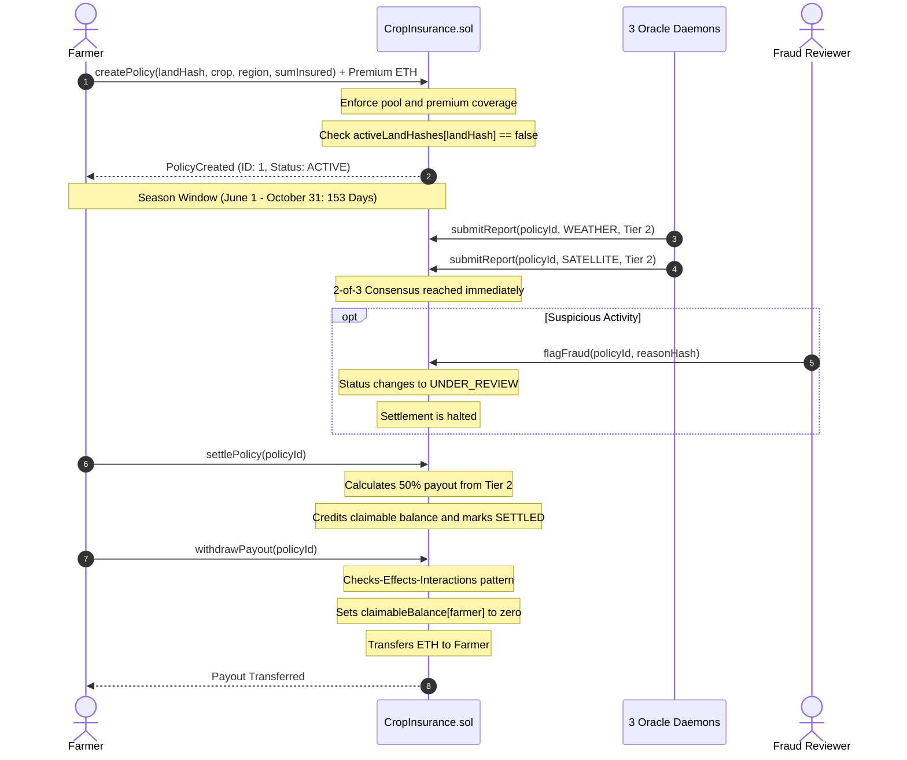

# Crop Insurance Chain: A Hardware-Free Multi-Source Blockchain Parametric Crop Insurance Protocol

[](LICENSE)
[](https://soliditylang.org/)
[](https://hardhat.org/)
[](https://www.python.org/)
[](https://react.dev/)

> **Academic Research Prototype Notice**: This repository is an open-source academic research prototype developed to study decentralized multi-source oracle consensus, smart contract solvency preservation, and parametric basis risk reduction. It does not constitute commercial insurance, does not handle legal fiat policies or real money, and is not certified by insurance regulatory authorities (e.g., IRDAI).

---

## Abstract

Parametric crop insurance offers automated, dispute-resistant indemnity for smallholder agriculture, yet existing decentralized solutions remain bottlenecked by expensive, fragile on-field IoT sensor infrastructure. We propose and implement **Crop Insurance Chain**, a hardware-free decentralized parametric insurance protocol tailored for rainfed groundnut (*Arachis hypogaea*) farming in the drought-prone Rayalaseema belt of Andhra Pradesh, India (Anantapur, Kurnool, and Kadapa districts; 2017–2024).

The protocol synthesizes three independent, public data streams—Open-Meteo ERA5-Land precipitation, Sentinel-2 MSI vegetative canopy index (NDVI), and NASA SMAP root-zone soil moisture—into an on-chain 2-of-3 consensus mechanism with median fallback. We formalize smart contract solvency enforcement ensuring total underwriting exposure never exceeds capital pool reserves, coupled with anti-reentrancy pull payments and cadastral duplicate-parcel guards. Across 24 historical district-years, multi-source consensus suppresses single-oracle fault error by 8.9x under 30% synthetic corruption (0.00% error on agreeing clean baselines), while a 4-tier parametric payout schedule achieves a basis risk MAPE of 7.72 pp (vs. 11.39–19.18 pp for binary triggers under the baseline 60% loss mapping).

---

## 1. Research Context & Prior Work Attribution

This prototype builds upon and extends recent academic literature on decentralized parametric agricultural insurance:

- **Base Paper**: *Frontiers in Blockchain (2025)*, "AgriInsureDON: Decentralized Oracle Network for Smart Contract-Based Agricultural Insurance".
  - *Focus*: IoT-dependent decentralized oracle networks, single temperature index, Ethereum Sepolia deployment with gas and transaction latency measurements.
- **Related Work**: *IEEE HSWTech (2025)*, "IoT-Sensor and Machine Learning Driven Agricultural Insurance on Permissioned Ledger".
  - *Focus*: On-field physical IoT sensors, CNN/LSTM yield forecasting, GAN/Autoencoder fraud detection on Hyperledger Fabric, evaluated purely on synthetic data.

### Our Research Contributions
1. **Hardware-Free Multi-Source Consensus**: Eliminates on-field IoT hardware deployment and battery maintenance by synthesizing three independent, freely available public remote-sensing and meteorological streams.
2. **On-Chain Solvency Invariant**: Smart contract mathematically enforces that `riskPoolBalance + premium >= reservedExposure + sumInsured`, preventing underwriter insolvency.
3. **Tiered Parametric Payouts**: Replaces crude binary (all-or-nothing) triggers with a 4-tier graduated schedule (0%, 25%, 50%, 100%) that minimizes basis risk.
4. **Adversarial Fraud Surveillance & Spatial Enhancement**: Dual-layer architecture combining on-chain cryptographic polygon hashing with off-chain nearest-neighbor spatial ML to detect jittered duplicate boundary attacks.
5. **Rigorous Empirical Audit**: Evaluated against real historical public earth observation data across 24 district-years (2017–2024) with full reproducible pipelines.

---

## 2. System Architecture & Workflows

### 2.1 System Architecture Diagram


### 2.2 Policy Lifecycle State Machine



### 2.3 End-to-End Execution Sequence




---

## 3. Trust Model & Threat Model

### 3.1 What is Enforced On-Chain (Deterministic Guarantees)
- **Solvency Invariant**: The contract cannot create a policy if liquid pool reserves cannot cover 100% of maximum potential loss.
- **Duplicate Land Parcel Guard**: `activeLandHashes` blocks identical polygon boundary hashes from being underwritten simultaneously.
- **2-of-3 Consensus Rule**: Requires at least two matching reports to settle without the third, or all three reports to compute the median. Single oracles cannot unilaterally dictate payouts.
- **Pull Payments**: Payouts are pulled by policyholders (`withdrawPayout`), eliminating push-payment reentrancy and denial-of-service vectors.
- **Access Control**: Roles (`DEFAULT_ADMIN_ROLE`, `ORACLE_*_ROLE`, `FRAUD_CHECKER_ROLE`, `DISPUTE_REVIEWER_ROLE`) are strictly verified via OpenZeppelin `AccessControl`.

### 3.2 What is Trusted (Explicit Assumptions)
- **Oracle Signers & Off-Chain Calculation**: The contract checks role signatures, but **does NOT verify that oracles calculated deficits correctly**, because raw satellite raster and weather calculations happen off-chain.
- **Rules Hash Audit Anchor**: `rulesHash` is committed on-chain at policy inception as an audit anchor. It provides cryptographic provenance for post-settlement audits, but is not evaluated inside the EVM.
- **Admin Governance**: The protocol admin is trusted to configure regional risk loadings responsibly and maintain sufficient risk pool capital.

### 3.3 Known Threat Surfaces & Mitigations
- **Jitter Attacks (Near-Duplicate Polygons)**: An adversary adding $+0.0001^{\circ}$ (~11m) bypasses exact hash checks. *Mitigation*: Off-chain nearest-neighbor spatial proximity surveillance flags near-duplicates for review.
- **Correlated Multi-Source Blackout**: Simultaneous corruption of all 3 data providers cannot be resolved by consensus. *Mitigation*: 7-day post-settlement dispute window (`openDispute`) and 14-day timeout escalation (`escalateTimeout`).

---

## 4. Public Data Sources & Agronomic Methodology

| Data Stream | Provider / Platform | Spatial Resolution | Observation Window | Status in Pipeline | Known Constraints |
|---|---|---|---|---|---|
| **Rainfall** | Open-Meteo API (ECMWF ERA5-Land) | ~9 km (0.1°) | Daily (153 days / Kharif) | **LIVE_API** | Gridded reanalysis interpolated over topography. |
| **Canopy NDVI** | Copernicus Sentinel-2 MSI Level-2A | 10 m (B8, B4) | 5-day revisit (cloud masked) | **CACHED_BENCHMARK_FALLBACK** | Cloud contamination in peak monsoon; GEE fallback. |
| **Soil Moisture** | NASA-USDA Enhanced SMAP | ~9 km grid | 3-day composite | **CACHED_BENCHMARK_FALLBACK** | Coarse 9 km cell vs 2 km parcel; GEE fallback. |

*Methodology*: Baselines are calculated using a dynamic **leave-one-year-out (LOO)** median across 2017–2024 to prevent current-season or future data leakage.

---

## 5. Experimental Results Summary

All results are reproducible via `python -m experiments.run_all`:

### 5.1 E1 & E2: Multi-Source Consensus & Pairwise Ablation
- **Consensus Behavior on Clean Historical Data**: Across all 24 historical district-years, the 2-of-3 consensus tier equals the weather tier in every season ($100\%$ agreement). Consequently, consensus provides no empirical accuracy gain over weather alone on clean historical records ($r_s = 0.8068$, MAPE $7.72$ pp vs. CMDI loss for both), while Soil Moisture alone achieves a lower MAPE ($6.15$ pp, $r_s = 0.8567$). The primary demonstrated benefit of multi-source consensus is **fault robustness (E3)** when an individual oracle fails or is corrupted.
- **Continuous Severity Reference (CMDI)**: Evaluated against the **Continuous Mean Deficit Index (CMDI)**—a threshold-free continuous severity index computed from the same three deficit percentages; independent of the tier cut-offs but not of the data sources—consensus and weather achieve $7.72$ pp continuous loss error, compared to $8.76$ pp for Satellite ($8.76$ pp) and $6.15$ pp for Soil.
- **Pairwise Ablation**: Under pairwise Variant A (disagreement yields 0% payout), farmers are penalized unfairly when sensors diverge (mean payout drops to $5.21\%$). 3-source consensus with median fallback maintains fair $11.46\%$ average payout without arbitrary penalty heuristics.

### 5.2 E3: Fault Robustness & Monte Carlo Verification
- **Error Suppression**: Under 30% synthetic fault injection on single oracles across all 24 historical seasons, consensus suppresses wrong payouts from **$30.13\% \to 3.40\%$** (**8.9x error reduction**).
- **0.00% Error on Agreeing Clean Data**: Across the 20 historical scenarios where clean oracles agree, single-source corruption produces **0.00% wrong payouts** because the two clean oracles always outvote the faulty one.
- **Multi-Oracle Independent Faults**: Under independent simultaneous faults across all three oracles, consensus error is **$4.38\% \pm 4.29\%$** at 10% fault rate, **$12.33\% \pm 6.81\%$** at 20% fault rate, and **$22.48\% \pm 8.79\%$** at 30% fault rate.
- **On-Chain EVM Parity**: 30 randomized on-chain policies on Hardhat confirmed **100% parity** with Python consensus simulation.

### 5.3 E4: Tiered Payout vs. Binary Triggers (Basis Risk)
- **Basis Risk Comparison**: The 4-tier schedule achieves **$7.72$ pp basis risk MAPE** under the baseline Linear Cap 60% mapping (outperforming Binary $\ge 1$ at $11.89$ pp, Binary $\ge 2$ at $11.39$ pp, and Binary $\ge 3$ at $19.18$ pp) and **$3.36$ pp** under convex damage curves (Convex Power 1.5).
- **The Sensitivity Caveat**: Under aggressive threshold compression (Linear Cap 45%), Binary $\ge 1$ achieves lower MAPE ($7.89$ pp vs. $13.74$ pp), but causes an unsustainable **$25.00\%$ over-payment rate** (+5.82 pp signed bias), threatening risk pool solvency. Tiered payouts maintain **0.00% over-payment**.

### 5.4 E5: Adversarial Fraud Detection Benchmark
- **Evaluation Scope**: Evaluated on **3,200 synthetic policy records** (288 fraud cases, 9.0% fraud rate, stratified 60/20/20 train/val/test split).
- **Spatial Enhancement**: Nearest-neighbor spatial proximity doubles duplicate boundary recall from **$26.67\% \pm 12.18\% \to 53.33\% \pm 11.30\%$** (+26.66 pp), raising overall recall from $76.90\%$ to $83.45\%$ and ROC-AUC to $0.9100$.
- **Precision Trade-off**: Precision experiences a minor drop from $90.90\% \to 85.34\%$ (-5.56 pp) due to false-positive alarms on legitimate neighboring farms, which are safely escalated to administrative review.
- **Feasibility Signal Caveat**: Duplicate-boundary recall is computed from roughly 15 positive test cases per seed in the test split (~72 duplicate fraud records across the dataset). Because the synthetic generator's coordinate jitter model and the spatial proximity feature are related, this improvement represents an algorithmic feasibility signal rather than resistance against real-world human adversarial evasion.

### 5.5 E6: Smart Contract Gas Profiling (N=30 Fresh Repetitions)
- `createPolicy`: $259,838.2 \pm 3,070.1$ gas (-5.98% vs. Hardhat profiler).
- `submitReport`: $75,720.0 \pm 0.0$ gas (-0.04% vs. Hardhat profiler).
- `settlePolicy (2-of-3)`: $153,704.0 \pm 2,207.9$ gas (-7.16% vs. Hardhat profiler).
- `withdrawPayout`: $32,394.0 \pm 0.0$ gas (0.00% variance; highly optimized).
- *Discrepancy Note on `resolveDispute`*: The +16.37% gas variance for `resolveDispute` ($121,526.6$ vs. $104,429$ profiler baseline) occurs because the empirical benchmark executes a post-withdrawal dispute lifecycle requiring full SSTORE slot updates (re-crediting `claimableBalance` from 0 to non-zero, costing 20,000 gas) rather than a pre-withdrawal resolution where storage slots remain un-cleared and warm.

---

## 6. Limitations & Threats to Validity

1. **Scope of Historical Data**: Evaluated across 24 historical district-years in Rayalaseema. Expansion to diverse agro-climatic zones is needed for broad generalization.
2. **Spatial Resolution & District-Level Scope**: Parametric drought indices and severity tiers are evaluated at the **district level** (macro-scale meteorological and satellite aggregation for Anantapur, Kurnool, and Kadapa), whereas policy creation, cadastral boundaries, and sum insured allocations operate at the individual farm parcel level. NASA SMAP operates at ~9 km resolution; cadastral parcels sample the enclosing regional grid cell.
3. **Threshold Assumptions**: Deficit cut-offs in `config/tier_rules.json` (rainfall 20/40/60%, NDVI and soil moisture 15/30/45% deficit) are research assumptions; deficits are measured against leave-one-year-out medians, the cut-offs are assumptions rather than government-notified APSDMA criteria or actuarially certified tables.
4. **Synthetic Fraud Ground Truth**: The fraud dataset comprises 3,200 synthetic records. While designed with continuous spectra and hard negatives, it cannot capture all adversarial human behaviors.
5. **Oracle Centralization**: In this prototype, oracles are role-holding signers. Mainnet implementation requires decentralized oracle networks or zero-knowledge data attestations.

---

## 7. Future Work

- **Decentralized Transport**: Integration with Chainlink Functions or UMA optimistic oracle networks for trust-minimized transport.
- **Cryptographic Attestations**: Zero-knowledge TLS (TLSNotary / zkWasm) proving satellite raster downloads originated untampered from Copernicus and NASA servers.
- **Cadastral GIS Integration**: Connecting direct land registry APIs (e.g., Andhra Pradesh Meebhoomi cadastral spatial database).
- **Layer 2 Deployment**: Porting to Layer 2 rollups (such as Arbitrum, Optimism, or Polygon PoS) to reduce execution gas fees by 10x to 50x compared to Ethereum L1.

---

## 8. Full Step-by-Step Reproduction Guide (Windows PowerShell)

Follow these exact steps from a fresh clone:

### Step 1: Clone & Navigate
```powershell
git clone https://github.com/crop-insurance-chain/crop-insurance-chain.git
Set-Location crop-insurance-chain
```

### Step 2: Install Node.js & Hardhat Dependencies
```powershell
npm install
npx hardhat compile
```

### Step 3: Setup Python Environment & Dependencies
```powershell
py -3.11 -m venv .venv
.\.venv\Scripts\Activate.ps1
pip install -r requirements.txt
```

### Step 4: Configure Environment File
```powershell
Copy-Item .env.example .env
```
*(Default test accounts work automatically for local development; no real API keys are required to reproduce cached experiments).*

### Step 5: Run Automated Protocol Verification Suite
```powershell
.\scripts\verify_all.ps1
```
*(Executes all 8 gates: Hardhat tests, Solhint, Pytest, Flake8, Vitest, Frontend TypeCheck, Frontend Build, and Master Experiments E1–E6. Total runtime: ~90 seconds).*

### Step 6: Launch Frontend Demo
In Terminal 1 (start local node):
```powershell
npx hardhat node
```
In Terminal 2 (seed demo environment):
```powershell
.\.venv\Scripts\python scripts/seed_frontend_demo.py
```
In Terminal 3 (launch web interface):
```powershell
Set-Location frontend
npm run dev
```
Open `http://localhost:5173` in your browser.

---

## 9. Third-Party Licenses & Data Attribution

This project is licensed under the [MIT License](LICENSE).
Third-party software libraries (`@openzeppelin/contracts`, `hardhat`, `ethers`, `web3.py`, `scikit-learn`, `pandas`, `numpy`, `matplotlib`, `react`, `vite`) are used under their respective open-source licenses.
Public data streams are used under their open research access terms:
- Meteorological data: Modified Copernicus Climate Change Service information [2017-2024] via Open-Meteo.
- Satellite imagery: Modified Copernicus Sentinel data [2017-2024].
- Soil moisture: Courtesy of NASA/JPL-Caltech and USDA-ARS.
See [`THIRD_PARTY.md`](THIRD_PARTY.md) for full licensing terms and legal notices.
