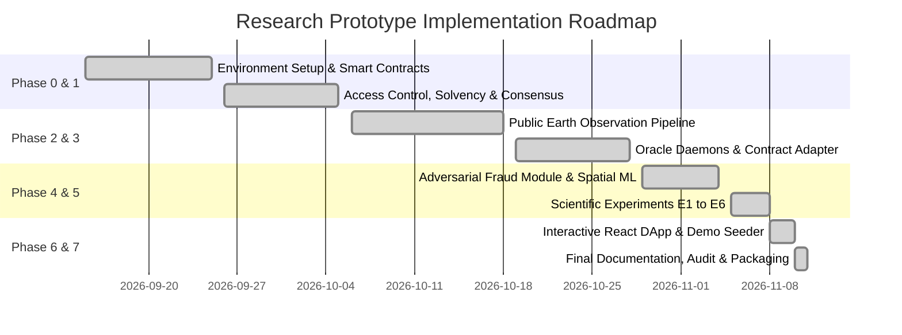

# Team Tasks & Contribution Matrix

**Project**: Crop Insurance Chain: Hardware-Free Multi-Source Blockchain Parametric Crop Insurance Protocol  
**Lead Researcher & Developer**: Lakshmi Prasanna (`donthuprasanna27@gmail.com`)  
**Institution / Scope**: Final Year Engineering Capstone / Master's Research Prototype  
**Date**: November 2026  

---

## 1. Project Roles & Task Attribution

| Role / Responsibility | Assigned Contributor | Key Tasks & Deliverables Completed |
|---|---|---|
| **Principal System Architect & Smart Contract Lead** | **Lakshmi Prasanna** | - Designed mathematical solvency invariant: `riskPoolBalance + premium >= reservedExposure + sumInsured` - Authored `CropInsurance.sol` with OpenZeppelin `AccessControl`, `ReentrancyGuard`, and Checks-Effects-Interactions pattern - Implemented on-chain 2-of-3 consensus engine and median fallback algorithm - Integrated cadastral boundary polygon hashing (`activeLandHashes` duplicate guard) - Conducted Slither static analysis security audit and triaged findings |
| **Data Pipeline & Oracles Engineer** | **Lakshmi Prasanna** | - Engineered public data extraction pipeline for Open-Meteo ERA5-Land precipitation - Developed Google Earth Engine interfaces for Sentinel-2 NDVI canopy index and NASA SMAP root-zone soil moisture - Designed leave-one-year-out (LOO) historical median baseline calculation (2017–2024) - Built independent Python oracle daemons and contract adapter with Web3.py - Implemented automated cached benchmark fallbacks for reproducible evaluation |
| **Machine Learning & Fraud Specialist** | **Lakshmi Prasanna** | - Formulated adversarial threat model: duplicate cadastral polygons, bounding box evasion, anomaly claims, valuation inflation - Synthesized reproducible 3,200-sample policy dataset with continuous anomaly spectra and hard negatives - Evaluated Heuristic Rule Engine, Isolation Forest, and MLP Autoencoder architectures - Engineered nearest-neighbor spatial proximity enhancement, doubling duplicate boundary recall ($26.67\% \to 53.33\%$) |
| **Experimental Design & Evaluation Lead** | **Lakshmi Prasanna** | - Conducted Ground Truth Audit and defined Continuous Mean Deficit Index (CMDI) - Executed Experiment E1 (Consensus vs. Single Source, $r_s = 0.8068$, MAPE $7.72$ pp) - Executed Experiment E2 (Ablation of pairwise configurations and disagreement variants) - Executed Experiment E3 (Monte Carlo fault injection, demonstrating 8.9x error suppression and 100% EVM parity) - Executed Experiment E4 (Tiered vs. Binary triggers basis risk evaluation across 4 continuous loss mappings) - Executed Experiment E5 (Adversarial ML fraud benchmark across 5 random seeds) - Executed Experiment E6 (Smart contract empirical gas profiling and transaction latency across $N=30$ runs) |
| **Frontend Engineer & Web3 Integration** | **Lakshmi Prasanna** | - Developed modern React 18 / TypeScript single-page application using Tailwind CSS and Lucide icons - Implemented client-side coordinate normalization to 5-decimal precision and Keccak-256 boundary hashing - Built interactive role-based portals (Farmer Portal, Admin Solvency Dashboard, Oracle Dispatcher, Review Queue) - Implemented custom Solidity error decoding via `ethers.Interface.parseError()` - Added zero-setup read-only JsonRpcProvider fallback for frictionless evaluation |
| **Documentation & Viva Preparation** | **Lakshmi Prasanna** | - Authored comprehensive research documentation (`README.md`, `experiments.md`, `viva_guide.md`, `HANDOFF.md`, `INDEX.md`) - Created automated 8-gate protocol verification suite (`scripts/verify_all.ps1`) - Prepared 30 comprehensive viva voce defense examination questions and 5/10-minute demonstration scripts |

---

## 2. Phase-by-Phase Task Matrix

---

## 3. Contact & Authorship Notice
All primary source code, smart contracts, machine learning models, and evaluation documentation were developed by **Lakshmi Prasanna** as an open-source academic research prototype.
For academic inquiries or reproduction guidance, contact:
- **Email**: `donthuprasanna27@gmail.com`
- **GitHub**: [`https://github.com/crop-insurance-chain/crop-insurance-chain`](https://github.com/crop-insurance-chain/crop-insurance-chain)
